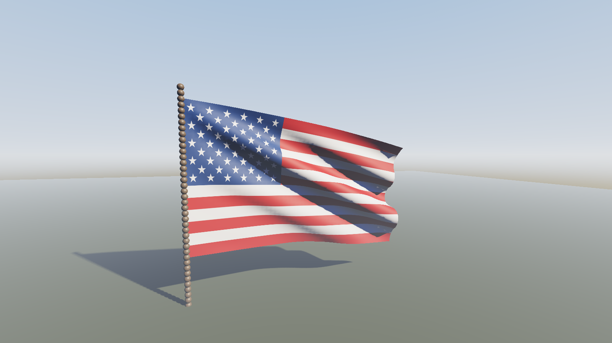
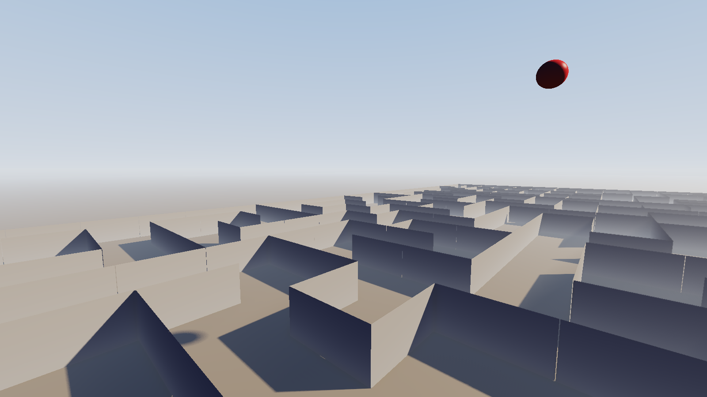
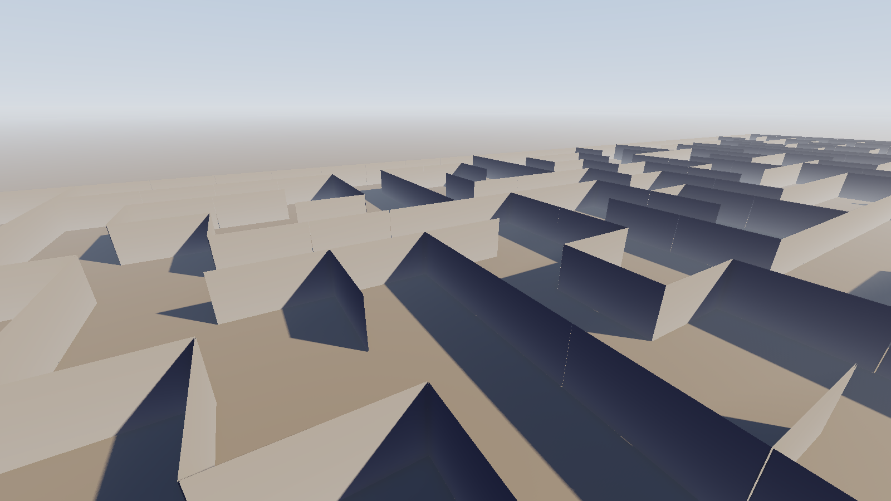
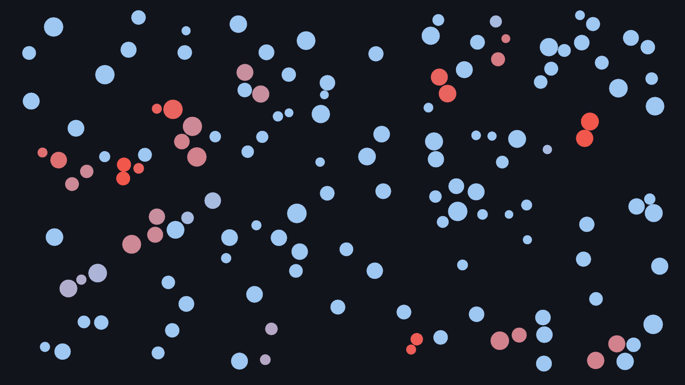
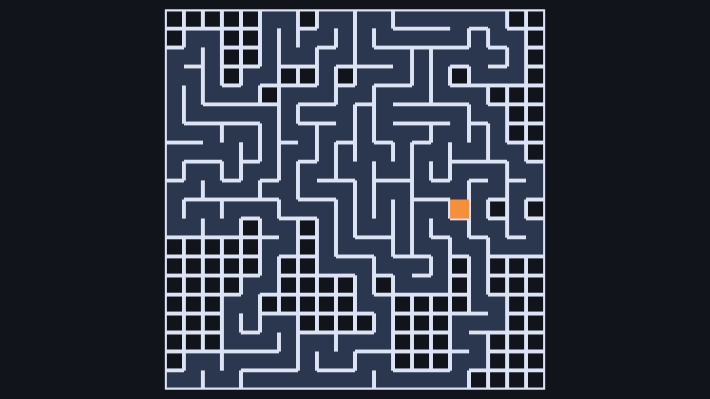

# OpenTK Projects

Four small real-time graphics demos built on OpenTK 4 and .NET 10, sharing one rendering library.



## Demos

| Demo | What it shows |
|---|---|
| `Cloth3D` | Verlet cloth: a textured flag with flexion springs and stretch limiting, casting shadows onto itself and the ground |
| `MazeGen3D` | First-person maze under a procedural sky, with soft shadows, ray-marched light shafts and ambient occlusion |
| `Collision2DPerformance` | Bouncing circles with quadtree broad-phase collision detection and elastic response. `--circles N` sets the count; radii scale to hold coverage constant, so it stays readable at any density |
| `MazeGen2D` | Depth-first maze carving, animated, batched into a single draw call |

## Requirements

- .NET 10 SDK
- A GPU and driver supporting OpenGL 3.3 core profile

No other setup is needed. `dotnet build` restores OpenTK and everything else.

On a laptop with switchable graphics, check which GPU actually runs the demo. Each one prints its
renderer string at startup, and warns if it looks integrated. Windows keys the choice to the
executable path, under Settings > System > Display > Graphics, so it has to be set again when the
build moves.

## Running

```bash
dotnet run --project src/Cloth3D
dotnet run --project src/MazeGen3D
dotnet run --project src/Collision2DPerformance
dotnet run --project src/MazeGen2D
```

## Capture

Every demo can record itself and exit, which is how the images in this README are produced and how
rendering is verified without a person watching the window.

```bash
# One still at frame 90
dotnet run --project src/Cloth3D -- --screenshot flag.png --frame 90

# 12 frames tiled into one contact sheet, quarter size, every 8th frame
dotnet run --project src/Cloth3D -- --filmstrip strip.png --frames 12 --every 8 --scale 4

# Numbered frames for an external encoder
dotnet run --project src/Cloth3D -- --sequence out/ --frames 48 --every 3 --scale 3
ffmpeg -framerate 20 -i out/frame_%04d.png \
  -vf "split[a][b];[a]palettegen[p];[b][p]paletteuse" -loop 0 flag.gif
```

| Flag | Meaning |
|---|---|
| `--frame N` | First frame to capture |
| `--frames N` | How many frames to capture |
| `--every K` | Capture one frame in every K rendered |
| `--scale S` | Downscale captured frames by S |
| `--pose P` | `MazeGen3D` only: `showcase` or `shadowdetail` |

Across a multi-frame capture `MazeGen3D` climbs the camera away from the shadow while orbiting it,
so a recording shows whether shadow edges stay stable as the view moves. A single screenshot holds
the pose the scene was framed with.

## Controls

The 3D demos use a grabbed-cursor first-person camera.

| Input | Action |
|---|---|
| `W` `A` `S` `D` or arrows | Move |
| `Q` / `E` | Rise / descend |
| Left `Shift` | Sprint |
| Mouse | Look |
| `Esc` | Quit |

## Tests

```bash
dotnet test
```

Four suites cover the parts that need no GL context: bounds and transforms, the shadow frustum fit
and the regression that closed [issue #1](https://github.com/yp3y5akh0v/opentk-projects/issues/1),
mesh and geometry builders, maze generation, the quadtree and its collision response, cloth
stretch and buckling, and command line parsing.

## Layout

```
src/OpenTkProjects.Core/    graphics library, knows nothing about any demo
  App/                      window host, capture driver
  Assets/Shaders/           GLSL, embedded into the assembly
  Capture/                  frame grabbing and PNG output
  Geometry/                 CPU-side mesh building
  Graphics/                 GL resource wrappers
  Input/                    first-person camera control
  Lighting/                 directional light, shadow frustum, atmosphere
  Rendering/                render passes and renderers
  SceneGraph/               transforms, nodes, cameras, bounds
  Spatial/                  quadtree
src/OpenTkProjects.Maze/    maze carving, no rendering and no OpenTK
src/<Demo>/                 one project per demo
tests/                      xunit suites, one per project with headless logic
```

## Rendering notes

Frame graph: shadow depth, ambient occlusion, then sky and lit geometry into a 16-bit float target,
then ray-marched scattering, then a composite that tone maps and encodes sRGB.



The sphere sits 2000 units above the ground and its shadow spreads into a wide penumbra; the walls
meet the ground and keep hard edges. Same shadow map, same filter.

- **Soft shadows.** Percentage-closer soft shadows with a blocker search. The penumbra of a
  directional light follows from its angular size alone, `2 * blockerToReceiverDistance *
  tan(angularRadius)`, so shadows are sharp where an object meets the ground and soften with
  separation. A fixed-radius filter cannot reproduce that.
- **Shadow frustum.** Fitted every frame to the intersection of what the camera sees and where
  casters can project. In light space the light runs down the Z axis, so a shadow lands on exactly
  the XY its caster occupies and texels outside that footprint can never hold a blocker. Callers
  supply no frustum dimensions. A ground plane reaching the fog horizon costs no shadow resolution.
- **Bias.** Normal offset sized in shadow texels, oriented toward the light so two-sided geometry
  does not push its lookup into itself, plus a small slope-scaled polygon offset.
- **Atmosphere.** Procedural sky with a solar disc and halo. Fog is the analytic integral of
  exponential height fog, tinted toward the sun when looking into it. The sky and the fog on
  geometry come from one shared GLSL chunk, so hazed geometry and the sky behind it cannot drift
  apart.
- **Light shafts.** Ray-marched single scattering: 64 steps along the view ray, each sampling the
  shadow map for occlusion, weighted by a Henyey-Greenstein phase function and attenuated by
  Beer-Lambert transmittance. The per-step shadow lookup is what makes a shaft stop at the wall
  casting it instead of smearing outward from the sun's screen position. Marched at reduced
  resolution and dithered with interleaved gradient noise.
- **Ambient occlusion.** Hemisphere-sampled SSAO against a view-space normal prepass, box blurred,
  modulating the ambient term only. Occluding direct sunlight is the shadow map's job.
- **Tone mapping.** Lighting is linear throughout; ACES tone mapping and sRGB encoding happen once,
  at composite.

## Simulation notes

- **Cloth.** Verlet integration with structural, shear and flexion springs. Flexion springs span two
  cells, pricing the one-cell zigzag the sheet buckles into where the weave goes slack while leaving
  broad folds free. Position relaxation alone is super-elastic, reaching 22 percent over rest length
  under this demo's wind and still 8 percent at forty sweeps, so weave springs are clamped to a
  maximum stretch afterwards.
- **Collision.** A quadtree narrows pairs to test, then contacts resolve as elastic impulses
  weighted by inverse mass, with positional separation to stop overlap accumulating. The broad
  phase queries each circle with a reach of its own radius plus the largest radius present, which
  makes the candidate set a guaranteed superset of the true contacts.

## Gallery

`MazeGen3D`. A 25x25 maze, lit wall faces against shadowed backs, fog closing the distance:



`Collision2DPerformance`. Red marks circles in contact, fading back to blue over 0.3 seconds:



`MazeGen2D`, mid-carve. Orange is the current cell, pale blue the standing walls, black the cells
not yet reached:


